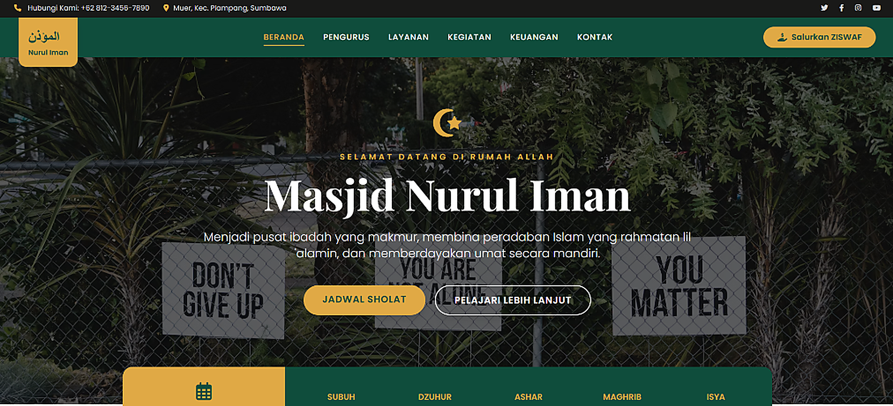

# 🕌 Mosque Management System (SIMasjid)


Mosque Management Information System (SIMasjid) is a comprehensive web platform built with **Laravel 12** and **Tailwind CSS**. It is specifically engineered to assist mosque committees (DKM) in administrative operations, announcing religious lectures and community agendas, managing financial cash flow with full transparency to congregants, and presenting a modern, pristine, and highly responsive user interface across all devices.

---

## 📸 High-Definition Application Preview

<p align="center">
  
</p>

---

## ✨ Core Features

### 🧑‍💻 Public Storefront & Congregant Portal
- **Interactive Landing Page:** Modern user interface presenting mosque profile, vision & mission, facilities, and daily activities.
- **Dynamic Prayer Times:** Real-time display of daily prayer schedules dynamically managed through centralized institutional configuration.
- **Financial Transparency:** Live ending cash balance indicator showcased directly on the homepage. Detailed inbound and outbound cash flows are accessible in real-time.
- **Lectures & Announcements:** Dedicated news and media portal for publishing religious study agendas, council schedules, and community notices.
- **Infrastructure Development Tracker:** Interactive showcase for tracking ongoing and completed physical mosque construction projects.
- **Mobile-First Responsive Layout:** Flawless cross-device experience across smartphones, tablets, and desktops with smooth hover transitions.
- **Consolidated Navigation:** Seamlessly merged service modules, committee directories, donation portals, and contact avenues minimizing clicks.

### 🔒 Administrative Content Management Backoffice
- **Visual Analytics Dashboard:** Executive cash flow summary featuring Chart.js visualizations that track financial trends by Day, Week, and Year.
- **Streamlined Content CRUD:** Intuitive Create, Read, Update, and Delete workflows for managing Activities, Programs, and Financial Records.
- **Scroll-Preserving Smart Pagination:** Precision pagination preserving user scroll positions during navigation across high-volume data tables.
- **Non-Intrusive Notifications:** Full SweetAlert2 integration providing graceful confirmations and eliminating intrusive browser-native alert dialogs.

---

## 🛡️ Security & Data Integrity Standards

1. **Comprehensive Audit Logging**
   The application quietly records sensitive administrative actions in the backoffice. Login attempts, record modifications, and deletions capture IP address, User Agent, and timestamp telemetry.
2. **Data Loss Prevention (Soft Deletes)**
   Deletions on vital financial statements, articles, and community programs are non-destructive. Data is shielded from the UI while remaining fully recoverable by database administrators.
3. **Execution Safety (CSRF & SQL Injection Immunity)**
   - All forms are guarded by anti-CSRF tokens.
   - 100% of input parameters are bound via Laravel Eloquent ORM PDO parameter binding, preventing SQL injection vulnerabilities.
4. **Brute-Force Rate Limiting**
   Administrative and user login entrypoints enforce strict throttling to mitigate credential-stuffing and automated dictionary attacks.
5. **Admin Route Obfuscation & Panel Hardening**
   Administrative endpoints do not use predictable routes (`/admin`). The access prefix is dynamically driven by the `ADMIN_PREFIX` environment variable (default: `masjid-portal-mgmt`). Direct access to `/admin` returns **HTTP 404 Not Found**, concealing management suites from automated scanners.

---

## ⚙️ Centralized Configuration (Single Source Of Truth)

All institutional data is centralized within a single configuration file (`config/masjid.php`):
- Mosque naming, abbreviations, and Arabic translations.
- Contacts, addresses, emails, and Google Maps embed endpoints.
- Social media profiles.
- Prayer schedule parameters.
- Bank accounts and ZISWAF donation channels.
- Organizational committee hierarchy (from Board of Advisors to Operations).

---

## 🚀 Local Installation & Setup Guide

### 1. System Requirements
- **PHP** 8.2 or higher
- **Composer** (PHP Package Manager)
- **Node.js & NPM**
- **MySQL / MariaDB**

### 2. Repository Cloning
```bash
git clone https://github.com/pranataa-labs/Mosque-Management-System.git
cd Mosque-Management-System
```

### 3. Core Dependency Installation
```bash
composer install
npm install
```

### 4. Database Environment Configuration
```bash
cp .env.example .env
php artisan key:generate
```
Configure your database credentials in `.env`:
```env
DB_CONNECTION=mysql
DB_HOST=127.0.0.1
DB_PORT=3306
DB_DATABASE=masjid_muer
DB_USERNAME=root
DB_PASSWORD=
ADMIN_PREFIX=masjid-portal-mgmt
```

### 5. Database Migration & Seeding
```bash
php artisan migrate --seed
```

### 6. Symbolic Storage Link
```bash
php artisan storage:link
```

### 7. Asset Compilation
```bash
npm run dev
# or for production build:
npm run build
```

### 8. Running Development Server
```bash
php artisan serve
```
- Public Portal: **`http://localhost:8000`**
- Administrative Portal: **`http://localhost:8000/login`**

---

<p align="center">
  <b>Mosque Management System (SIMasjid)</b><br>
  Engineered with ❤️ to foster digital literacy and institutional transparency.
</p>
